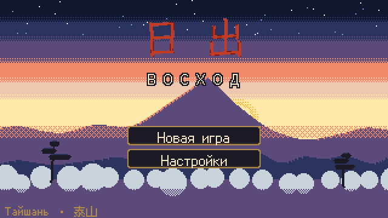
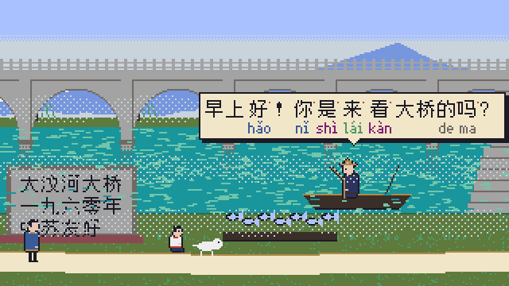
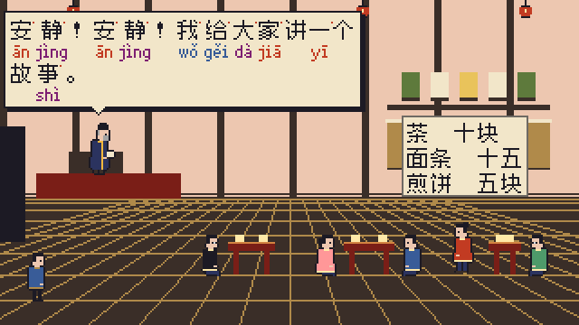
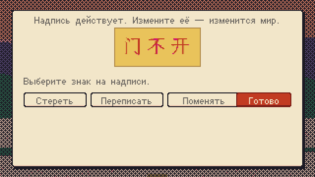
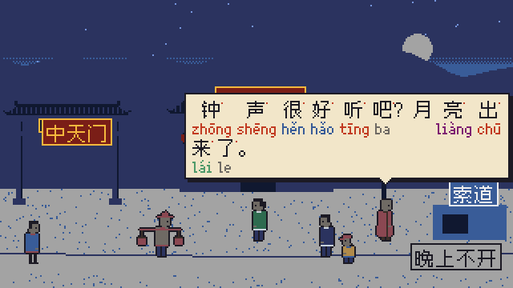
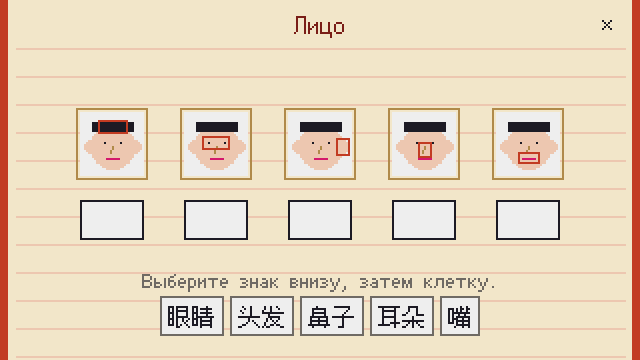
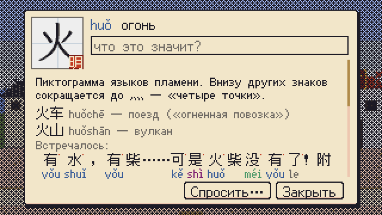
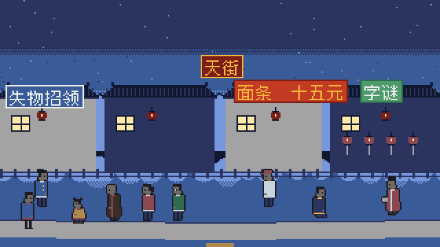
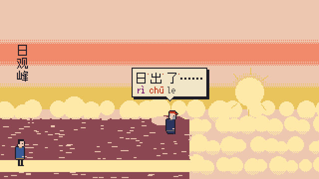

# 日出 · Восход

Пиксельное приключение-расшифровка о восхождении на гору Тайшань (泰山). Вы не знаете китайского — а люди вокруг говорят только по-китайски, и вывески, и предметы в сумке подписаны иероглифами. Слушайте, смотрите, записывайте догадки, раскладывайте знаки по страницам дневника — как в **Chants of Sennaar**, только язык настоящий: за игру вы встретите **все 601 слово HSK 1–3** и ещё полторы сотни знаков истории, всего **745 иероглифов**.



| | |
|---|---|
|  |  |
|  |  |
|  |  |
|  |  |

## История

Дед оставил вам коробку: письмо, дневник на китайском, старое фото и кисть. В 1958–1960 годах он, молодой советский инженер, строил мост через реку Давэньхэ у подножия Тайшаня и подружился с Ли Мином — сыном деревенского учителя. Они обещали друг другу встретить на вершине рассвет в день осеннего равноденствия. Дед уехал и не вернулся. Письмо Ли Мину он так и не отправил.

Теперь равноденствие через два дня, письмо у вас, а переводчиком дед велел не пользоваться: «Учись, как учился я, — у людей».

**Пролог и восемь глав, 30 сцен:** квартира деда → аэропорт Цзинаня, вокзал и поезд → Тайань (гостиница, улица, банк, храм Дай) → деревня у моста деда и сельская школа → рынок, чайная и Красные ворота → обитель Доуму, долина Каменной сутры и Средние небесные ворота → ночной подъём по Восемнадцати поворотам → Небесная улица на вершине → восход на Пике созерцания солнца. Дневник деда (17 записей) открывается по ходу пути — и становится понятным по мере того, как понятны его знаки.

## Что в игре

- **Всё по-китайски.** Реплики, вывески, таблички, меню, ценники, предметы в сумке (иконка + иероглифы). По-русски — только мысли героя и интерфейс.
- **Дневник**: догадки под каждым знаком (видны везде), страницы подтверждения — с картинками, иконками или фразами с пропуском. Верно разложенная страница открывает у знаков значение, пиньинь (цвет = тон), озвучку, происхождение и живые слова. Журнал услышанного, 32 грамматические заметки, глоссарий слов, режим «Повторение».
- **Разговоры**: люди задают вопросы, а вы отвечаете, составляя фразу из встреченных знаков. «Да» — повтор глагола (要, 是, 能…), как в китайском.
- **Словесная магия.** Кисть деда пишет только те знаки, которые вы понимаете. Написанное сбывается: 火 зажигает печь, 雨停 останавливает ливень, 风吹云开 разгоняет облака, 画龙点睛 оживляет дракона. Неподтверждённые знаки дают лишь «тень смысла».
- **Надписи-талисманы**: на горе написанное действует — сотрите 不 в «门不开», и ворота откроются; перепишите «水大» на «水小», поменяйте местами перепутанные знаки на указателе.
- **Головоломки**: счёт с счётными словами (七条鱼), лицо на доске, сборка знаков из частей (人+木=休, 日+一=旦), древние формы на стеле Цинь, список носильщика, поднос в чайной, торг, колокола, развилки в тумане, перекличка носильщиков, бюро находок, загадки Лиса, парные надписи, загадка 虫二.
- Пиксельная графика 320×180 в стиле [Pyxel](https://github.com/kitao/pyxel): 32 цвета, смена времени суток перекраской палитры, туман, дождь, ночь с фонарём, восход. Пентатонические мелодии и звуки на встроенном синтезаторе Pyxel.

## Управление

- Клик по земле — идти; по человеку — заговорить; по предмету — осмотреть; стрелки у краёв — дальше.
- Клик по иероглифу — карточка знака: догадка, где встречался, после подтверждения — всё о нём.
- Предмет: выберите в сумке (внизу), затем кликните по цели.
- **J** — дневник, **B** — кисть, **M** — карта, **H** — подсказка, **Пробел** — дальше, **Esc** — меню.

## Запуск

Нужен Python 3.11+.

```bash
pip install -U pyxel
python -m richu
```

Прогресс сохраняется автоматически (в браузере — в `localStorage`).

### Версия для браузера

```bash
python scripts/build_web.py      # build/richu.pyxapp и build/site/index.html
```

Страница запускает игру на веб-рантайме Pyxel (Pyodide). В браузере работает озвучка знаков (Web Speech, zh‑CN). CI собирает её и публикует на GitHub Pages.

## Разработка

```bash
pip install -e ".[dev]"
pytest                      # логика, контент, вся игра от пролога до восхода без окна
python scripts/e2e.py       # вся игра через настоящий интерфейс: клики, реплики, пады, концовка (~25 с)
python scripts/shots.py shots --chapter 3   # скриншоты сцен главы
python scripts/coverage.py --missing        # покрытие HSK 1–3 текстами игры
python scripts/build_fonts.py               # пересобрать шрифты под набор знаков игры
```

Тесты проверяют, что полный проход встречает все 601 слово HSK 1–3, открывает каждую страницу дневника, что каждая реплика использует только знаки из словаря, у каждого знака верный пиньинь, а шрифты содержат всё, что игра показывает.

Устройство:

- `richu/engine` — экраны, ввод, текст и шрифты, планировщик корутин (сценарии сцен — `async def`).
- `richu/core` — логика без графики: состояние, дневник, магия (разбор фраз-заклинаний), талисманы, головоломки, headless-прогон.
- `richu/content` — словарь (745 знаков: пиньинь, значение, происхождение, слова), главы со сценами и сценариями, страницы, тексты, грамматика.
- `richu/art`, `richu/ui` — палитра, процедурные фигуры и сцены, иконки 16×16; окна дневника, карточек, пазлов.
- `docs/` — анализ, дизайн и план (`docs/v1/` — первая версия на TypeScript).

## Лицензии и источники

- Код — MIT.
- Шрифты (SIL OFL 1.1): [Fusion Pixel Font](https://github.com/TakWolf/fusion-pixel-font) (TakWolf) — пиксельные 12 и 10 px; [LXGW WenKai](https://github.com/lxgw/LxgwWenKai) — знаки кистью. См. `richu/assets/fonts/OFL.txt`.
- Данные: разбор знаков и частотность — [hanzi](https://github.com/nieldlr/Hanzi) (MIT), списки HSK — [chinese-lexicon](https://github.com/peterolson/chinese-lexicon) (ISC), проверка пиньиня — [pypinyin](https://github.com/mozillazg/python-pinyin) (MIT).
- Движок — [Pyxel](https://github.com/kitao/pyxel) (MIT).
