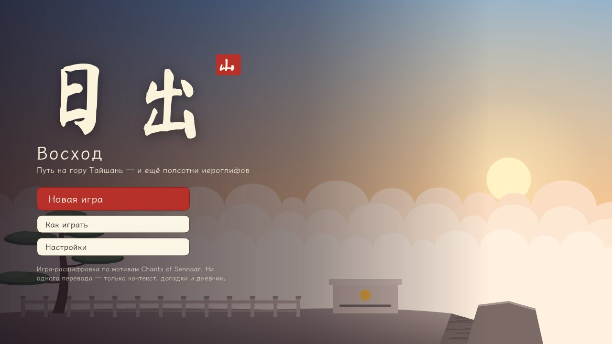
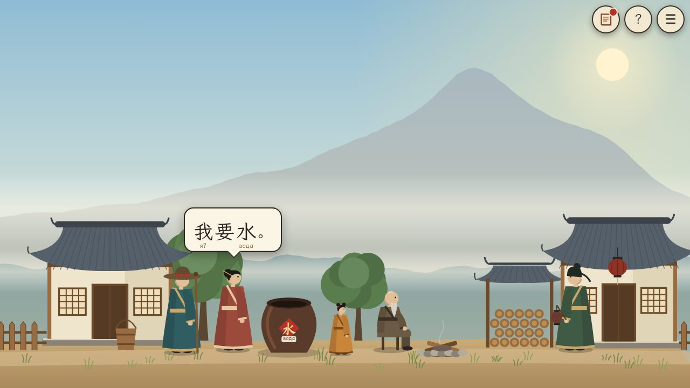
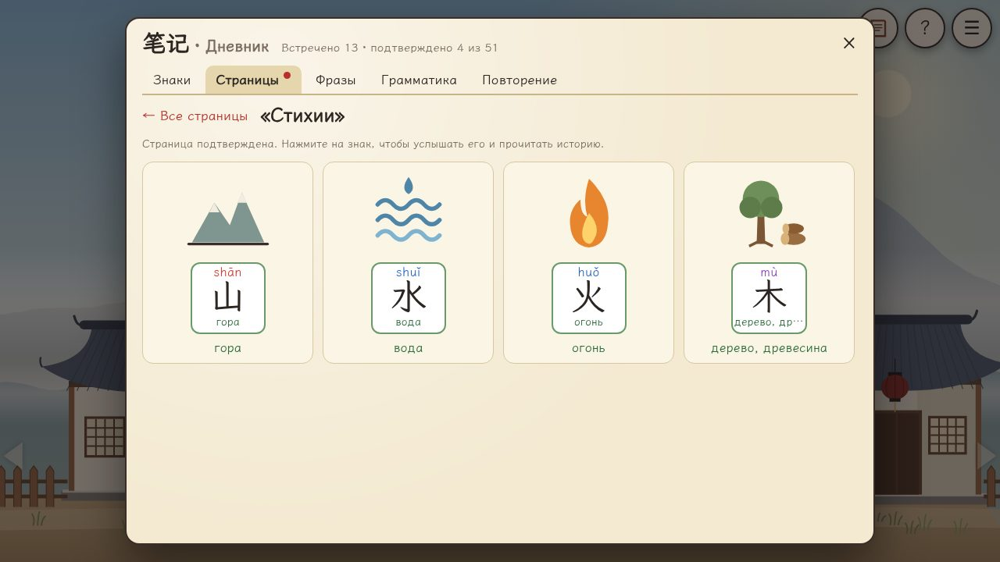
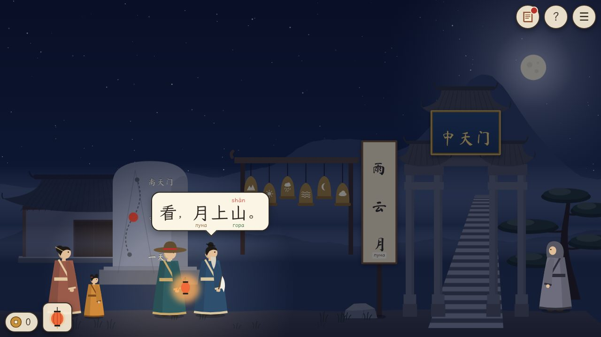
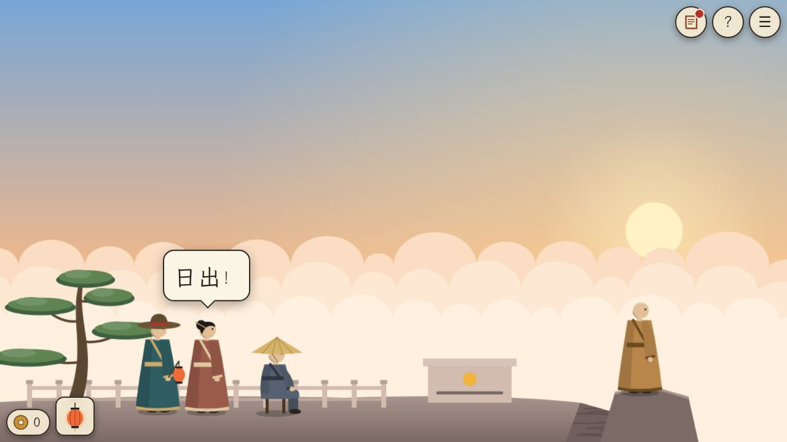

# 日出 · Восход

Игра-расшифровка о восхождении на гору Тайшань (泰山). Вы — путник из далёких земель, который не знает китайского. Все реплики и надписи — только иероглифами. Слушайте людей, смотрите, что они делают, записывайте догадки в дневник и подтверждайте их — как в **Chants of Sennaar**, только язык настоящий.



| | |
|---|---|
|  |  |
|  |  |

## Что в игре

- **4 главы, 13 сцен** реального паломнического пути: деревня у подножия → рынок и чайная у Первых небесных ворот (一天门) → Средние небесные ворота (中天门) и Восемнадцать поворотов (十八盘) → Южные небесные ворота (南天门), вершина и рассвет на Пике созерцания солнца (日观峰).
- **51 иероглиф**: пиктограммы (日 月 山 水 火 木 人…), числа 1–10, глаголы и частицы (要 有 没 看 开 吗…), стороны света и составные знаки (明 休 林 旦).
- **Дневник**: догадки к каждому знаку, 11 страниц подтверждения с рисунками, журнал услышанных фраз, 11 грамматических заметок, режим «Повторение».
- **После подтверждения** знак получает значение, пиньинь (цвет = тон), озвучку (Web Speech, zh‑CN), историю происхождения, древнюю форму и живые слова с ним.
- **Головоломки**: ответы из знаков, заказы в чайной (числа, 大/小, 茶/水), храмовые колокола, сборка иероглифов из частей, стела Цинь с древними формами, Стела без надписей.
- Процедурная графика (SVG), синтезированная пентатоника и звуки, работа в любом браузере, в том числе на телефоне (лучше горизонтально). Прогресс сохраняется автоматически.

## Как играть

- Клик по земле — идти; по человеку — заговорить; по предмету — взять или осмотреть; стрелки у краёв экрана ведут дальше.
- Клик по любому иероглифу — записать догадку. Она появится под этим знаком везде.
- Когда встречены все знаки страницы дневника, разложите их по рисункам. Страница засчитывается, только если всё верно.
- Предмет: выберите его в сумке (внизу слева), затем кликните по цели.
- Клавиши: **J** — дневник, **H** — подсказка, **Пробел** — дальше, **Esc** — меню.

## Запуск

Нужен Node.js 22+.

```bash
npm install
npm run dev        # http://localhost:5173
npm run build      # статическая сборка в dist/ (~320 КБ)
npm run preview    # посмотреть сборку
```

Сборка полностью статическая и открывается с любого пути (`base: './'`). Workflow `.github/workflows/ci.yml` проверяет типы, гоняет тесты и публикует `dist/` на GitHub Pages при пуше в `main` (в настройках репозитория: *Pages → Source: GitHub Actions*).

## Проверки

```bash
npm run typecheck  # TypeScript в strict-режиме
npm test           # Vitest: логика, целостность контента, полные прохождения
npm run e2e        # прохождение всей игры в браузере (нужен запущенный npm run preview)
```

- `tests/walkthrough.test.ts` проходит игру от пристани до восхода через «безголовый» контекст скриптов, проверяет, что тупиков нет и что игрок, не делающий ошибок, встречает все знаки главы до её конца.
- `tests/content.test.ts` проверяет, что каждый иероглиф в сценарии есть в лексиконе, каждый знак можно подтвердить, переходы между сценами корректны, а персонажи не перекрывают выходы.
- `scripts/e2e.mjs` кликает по интерфейсу в Chromium (Playwright) и доходит до финала. Путь к браузеру можно задать через `CHROMIUM=/path/to/chrome`, скриншоты — через `E2E_SHOTS=dir`.

## Устройство

```
src/core/      логика без DOM: состояние, дневник, головоломки, пути, подсказки, headless-контекст
src/content/   лексикон, страницы, грамматика, предметы, подсказки, главы 1–4 (сцены и скрипты)
src/art/       процедурная графика: палитры, горы, архитектура, персонажи, иллюстрации, древние формы
src/ui/        интерфейс: сцена и ходьба, реплики, дневник, карточка знака, головоломки, меню, звук
dev/gallery.*  галерея сцен для художественной отладки (npm run dev → /dev/gallery.html?debug)
scripts/       генерация шрифтов-подмножеств, e2e-прохождение
docs/          анализ, дизайн игры, план
```

Скрипты сцен пишутся против интерфейса `ScriptContext` (`say`, `ask`, `give`, `puzzle`, `goto`…). В игре его реализует `ui/runtime.ts` с анимациями, в тестах — `core/headless.ts`.

Шрифты — подмножества только нужных знаков (≈90 КБ вместо 30 МБ). После изменения текстов с новыми иероглифами:

```bash
pip install fonttools brotli
npm run fonts
```

## Документы

- [Анализ](docs/ANALYSIS.md) — механики Chants of Sennaar, почему китайский ложится на эту формулу, выбор сеттинга и технологий.
- [Дизайн игры](docs/GAME_DESIGN.md) — сюжет, сцены, сценарий реплик, лексикон, головоломки, грамматика.
- [План](docs/PLAN.md) — этапы реализации и как проверяется результат.

## Лицензии

Шрифты LXGW WenKai и Ma Shan Zheng распространяются по SIL Open Font License 1.1 — см. [src/assets/fonts/OFL.txt](src/assets/fonts/OFL.txt). Игра вдохновлена Chants of Sennaar (Rundisc) и не использует её материалов.
